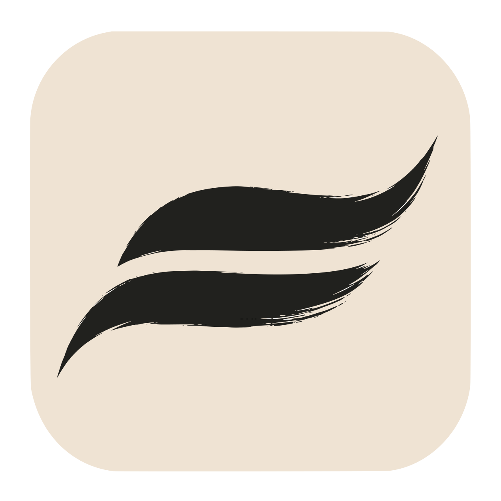

# DeskPace

DeskPace 是一款 macOS 菜单栏工具，让你调快四指切换桌面时松手后的动画。滑动时桌面仍然跟手，松手后按你选的速度平滑到位。切到相邻桌面、切入全屏 App 或回弹到原桌面，都使用同一倍率。

## 安装与使用

需要 macOS 26 或更高版本，以及已启用四指切换桌面手势的触控板。已在 macOS 27 内建屏上实测。[兼容性与实测结果](docs/motion-verification.md)

1. 从 [GitHub Releases](https://github.com/wawaRou/deskpace/releases/latest) 下载 `DeskPace-<版本号>.zip`，解压后将 `DeskPace.app` 拖入「应用程序」并打开。
2. 点击菜单栏里的 DeskPace 图标，选择「授权辅助功能…」，在系统设置中允许 DeskPace 调节手势。
3. 将滑块从 **1×（系统原速）** 调到想要的速度，最高 **4×**。下一次四指横移就会采用新倍率，设置会自动保存。

仓库私有期间，请登录 GitHub 从 Releases 下载更新。仓库公开后，可直接在菜单栏面板点「检查更新…」。

## 从源码运行

安装 Xcode Command Line Tools，使用支持 macOS 26 的 SDK，在项目根目录执行：

```sh
./build.sh
open build/DeskPace.app
```

[更新时保留授权](docs/releasing.md#本地构建与辅助功能授权) · [反馈问题](https://github.com/wawaRou/deskpace/issues)
