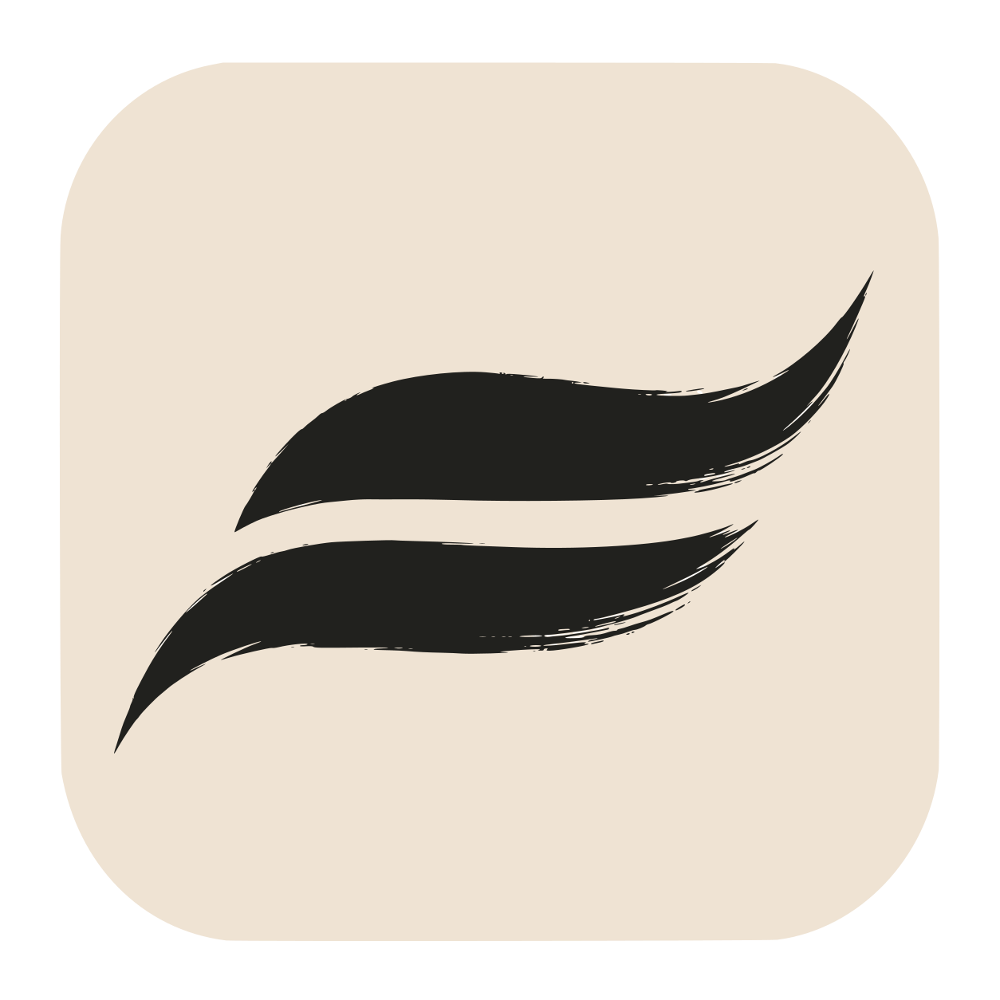

# DeskPace

[English](README.md) · 简体中文

DeskPace 是一款 macOS 菜单栏工具。四指切换桌面时，桌面照常跟着手指移动。松手后，你可以让剩下的动画以最高 4 倍速走完。切到全屏 App、划到一半松手回到原桌面，也可以调速。

## 安装

需要 macOS 26 或更高版本，并在触控板设置中启用四指切换桌面的手势。各系统版本和显示器的测试情况见[实测记录](docs/motion-results.md)。

1. 下载 `DeskPace-<版本号>.zip`，解压后将 `DeskPace.app` 拖入「应用程序」。[GitHub Releases](https://github.com/wawaRou/deskpace/releases/latest)
2. 打开 DeskPace，点击菜单栏图标。如果面板提示需要权限，点「授权辅助功能…」，在「系统设置 → 隐私与安全性 → 辅助功能」中启用 DeskPace。

v0.1.7 下载包使用临时签名，未经 Apple 公证。首次打开时，macOS 可能会阻止启动。

## 调整速度

拖动面板里的滑块，选择 1×（系统原速）到 4× 之间的倍率。下一次划动就会生效，退出后也会保存。

点「恢复原速」可以回到 1×。

## 设置

点菜单栏面板里的「设置…」可以切换简体中文或 English，也可以检查更新。开启「登录时启动」后，下次登录这台 Mac 时，DeskPace 会自动出现在菜单栏，沿用上次保存的倍率。

[反馈问题](https://github.com/wawaRou/deskpace/issues) · [源码构建与开发](CONTRIBUTING.md) · [MIT 许可证](LICENSE)
